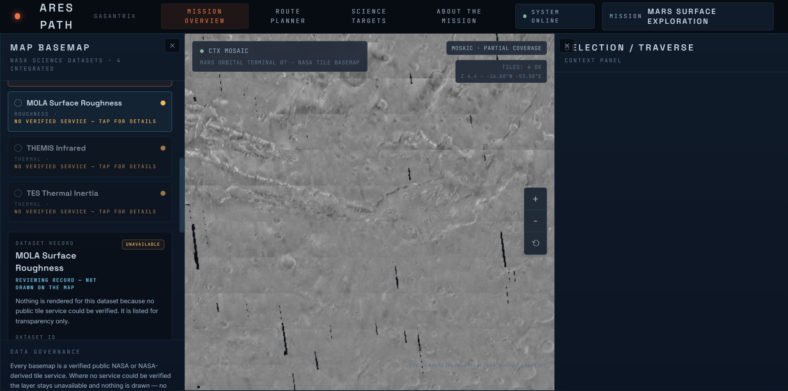
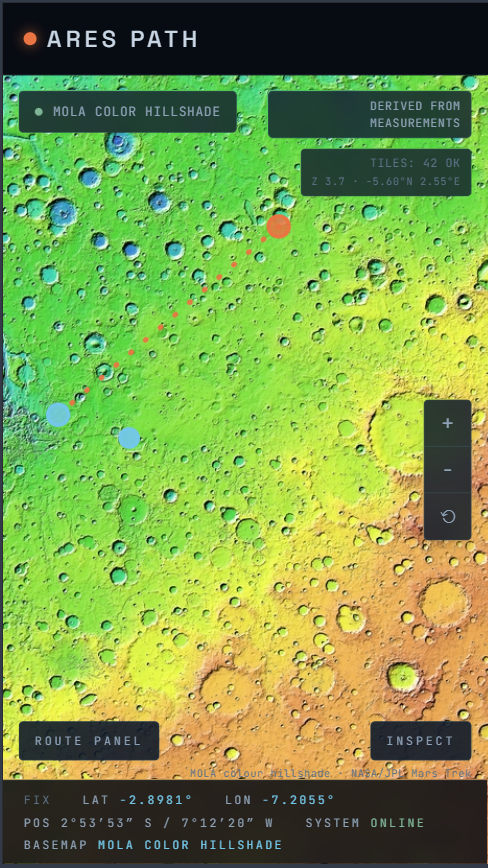
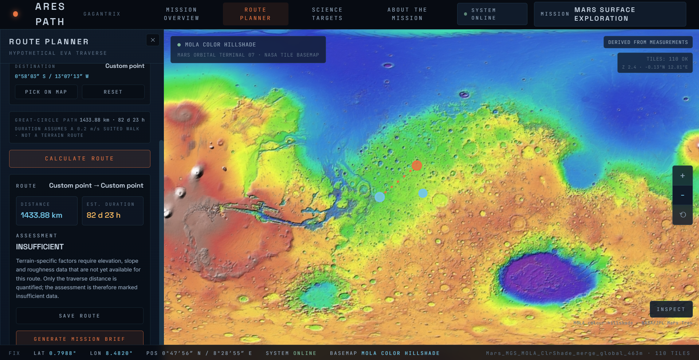

# ARES PATH — GAGANTRIX

**Every Step Matters.**

An immersive Mars exploration and astronaut route-planning terminal, built as a prototype for the **NASA Space Apps Challenge 2026**.

ARES PATH combines publicly available NASA Mars science imagery into an interactive mission console: an orbital map of Mars rendered in a Mars-specific coordinate system, curated science targets, a traverse planner with an honest terrain assessment, and a downloadable mission brief.

> **Research prototype, not a navigation system.** ARES PATH is an educational visualisation tool. It is not flight-qualified, not terrain-aware, and must never be used for real surface operations.

**Live demo:** https://ares-path.vercel.app

---

## Screenshots

Captures of the running prototype (live at https://ares-path.vercel.app).

| # | File | What it shows |
|---|------|---------------|
| 1 | `01-landing.png` | Landing page hero with "INITIATE MISSION" and "EXPLORE TECHNOLOGIES" entry points |
| 2 | `02-mola-hillshade.png` | Main map with MOLA color hillshade active, HUD, tile counter, and attribution visible |
| 3 | `03-layer-unavailable.png` | Layer panel scrolled to an UNAVAILABLE dataset record (MOLA roughness / THEMIS / TES) with its reason text |
| 4 | `04-route-planner.png` | Route planner with custom picked endpoints, calculated great-circle route, distance, duration, and INSUFFICIENT assessment |
| 5 | `05-science-targets.png` | Science targets panel showing a target's summary, why it matters, limitations, and source |
| 6 | `06-zoom-controls.png` | Map zoomed in with the +/−/reset zoom controls and measurement badge visible |
| 7 | `07-mission-brief-view.png` | Mission brief generated on-screen (mission ID, coordinates, distance, duration, data limitations) |
| 8 | `08-mission-brief-pdf.png` | Downloaded PDF mission brief (A4 document with the same content) |
| 9 | `09-mobile-drawers.png` | Compact view (~390 px) with the left drawer open over the map and backdrop visible |







---

## Quick start

```bash
npm install
npm run dev       # Vite dev server
npm run build     # tsc -b && vite build → dist/
npm run preview   # serve the production build
```

Stack: React 19 · TypeScript · Vite 8 · Tailwind CSS 3 · Leaflet 1.9 · Recharts · jsPDF · Lucide.

No API keys are required. Every tile service below is public and CORS-enabled
(`access-control-allow-origin: *`), so tiles are requested directly by the browser.

---

## What the prototype does

| Area | Behaviour |
| --- | --- |
| Landing | Cinematic hero, mission status strip, two entry points (mission / technology) |
| Mission console | Leaflet map of Mars on a Mars equirectangular CRS, with visible + / − / reset zoom controls |
| Map layers | Radio-selected base layer: MOLA hillshade, colorized DEM, HiRISE, CTX; unresolved layers are inspectable but never drawn |
| Layer transparency | Active dataset + source endpoint, live tile counts, per-dataset record with resolution, coverage, projection and limitations |
| Failure handling | If no tile can be fetched, an explicit "basemap unavailable" panel replaces the map — never invented terrain |
| Explore regions | Jezero Crater, Gale Crater / Aeolis Mons, Valles Marineris — each frames its real bounding box |
| Science targets | Curated points of interest with summary, why it matters, limitations and source |
| Route planner | Pick both traverse endpoints directly on the map (or reset to the Jezero/Aeolis presets), then compute great-circle distance, duration and a transparent assessment |
| Mission brief | Generated report with a real PDF download and a printable document view |
| Education | "Understand your planet" Mars facts with sources |
| Telemetry | Coordinate readout in decimal degrees and DMS, active dataset, system state |
| Responsive | Both side panels collapse to a toggle at any width; below 1024 px they become drawers with a backdrop, and the map is inset by the docked panels' widths so zoom and target focus land in the visible part of the map |

---

## Verified NASA data sources

Only services that were actually fetched during integration are listed as
*integrated*. Each returned HTTP 200 with a real image body.

| Dataset | Service | Tiling | Status |
| --- | --- | --- | --- |
| **MGS MOLA Color Hillshade** (`Mars_MGS_MOLA_ClrShade_merge_global_463m`) | NASA/JPL **Mars Trek** WMTS | `default028mm`, `EPSG::104905`, 256 px JPEG, levels 0–7 | Integrated |
| **Mars Colorized DEM** | Esri ArcGIS **OnMars** `MColorDEM` | `GCS_Mars_2000_Sphere` (wkid 104971), 512 px JPEG, LOD 0–17 | Integrated |
| **HiRISE mosaic** | Esri OnMars `HiRISE` | same as above, 512 px PNG | Integrated (targeted footprints only) |
| **CTX mosaic** | Esri OnMars `CTX` | same as above, 512 px PNG | Integrated (partial coverage) |
| **MGS MOLA Global Surface Roughness** | — | — | **Not verified — not integrated** |
| THEMIS infrared / TES thermal inertia | — | — | **Not verified — not integrated** |

### MOLA Color Hillshade

- Dataset id: `Mars_MGS_MOLA_ClrShade_merge_global_463m`
- Capabilities: `https://trek.nasa.gov/tiles/Mars/EQ/Mars_MGS_MOLA_ClrShade_merge_global_463m/1.0.0/WMTSCapabilities.xml`
- Tiles: `https://trek.nasa.gov/tiles/Mars/EQ/Mars_MGS_MOLA_ClrShade_merge_global_463m/1.0.0/default/default028mm/{level}/{row}/{col}.jpg`
- Verified metadata: format `image/jpeg`, TileMatrixSet `default028mm`, SupportedCRS `urn:ogc:def:crs:EPSG::104905`, `TopLeftCorner -180 90`, `TileWidth/Height 256`, levels 0–7, BoundingBox 180.0000°W – 179.9983°E / 89.9992°S – 90.0000°N.
- Resolution: 463 m/px source grid; the published pyramid tops out at level 7 (~326 m/px at the equator).

### Esri OnMars services

- Metadata: `https://astro.arcgis.com/arcgis/rest/services/OnMars/{MColorDEM|HiRISE|CTX}/MapServer?f=pjson`
- Tiles: `https://astro.arcgis.com/arcgis/rest/services/OnMars/{service}/MapServer/tile/{level}/{row}/{col}`
- Verified metadata: `wkid 104971` `GCS_Mars_2000_Sphere` (sphere radius 3 396 190 m), `tileCols/tileRows 512`, origin `{x: -180, y: 90}`, LOD 0–17, full extent ±180°/±90°.
- These are **Esri-published mosaics of NASA/JPL/ESA/DLR/USGS data**, not NASA-run endpoints; attribution is shown in the dataset record.

### MOLA Surface Roughness — requested, not available

This dataset could **not** be verified, so nothing is rendered for it:

- Trek's WMTS `GetCapabilities` returns **HTTP 404** for `Mars_MGS_MOLA_Roughness_merge_global_463m` and for the variants `Mars_MGS_MOLA_SurfaceRoughness_merge_global_463m`, `Mars_MGS_MOLA_Rough_merge_global_463m`, `Mars_MOLA_Roughness_global_463m`.
- ArcGIS ImageServer paths with those names answer **HTTP 200 but return an empty stub** (`{"description": ""}`), not a service definition.
- The official Trek service directory lists **76 services**; none is a roughness layer.

The entry stays in the layer list, marked `UNAVAILABLE`, and can be opened to read
exactly this evidence. Route assessments therefore still report surface roughness
as unavailable instead of inventing a value.

---

## Mars map: an equirectangular CRS, not Earth's

Both integrated providers serve **geographic 2:1 pyramids** over the full
360° × 180° graticule, anchored at the north-west corner (−180°, +90°). So
`src/utils/marsCRS.ts` implements a Mars **equirectangular (plate carrée)** CRS:

- World width `256 · 2^zoom` px, height exactly half that. One pixel covers the same number of degrees on both axes, so the y divisor is `worldSize / 360` — **not** `worldSize / 180`. Getting that wrong halves the latitude scale and requests the wrong tile row.
- No Mercator warp, therefore no ±85.0511° clamp and no singularities at the poles.
- `wrapLng: [-180, 180]` but **no `wrapLat`**. Leaflet derives its row-wrap bounds by projecting `wrapLat`; on a north-up grid that produces an inverted range and tiles past the south pole (`404`s). Latitude must not wrap for a planetary map.
- `getProjectedBounds()` returns the 2:1 rectangle, and the map is clamped with `maxBounds [-90, -180] … [90, 180]` so a drag cannot leave the planet.
- The zoom floor is derived from the container size — `log2(max(width / 256, height / 128))` — so the planet always fills the viewport. Below that floor the 2:1 world is smaller than the screen and `maxBounds` snaps every drag back to the middle, which looks like a map that cannot be panned; that floor is re-applied on every resize.
- `distance()` is great-circle haversine on the Mars sphere radius **3 396 190 m**, matching `GCS_Mars_2000_Sphere`.

### Tile-level arithmetic (`src/services/nasa/marsTiles.ts`)

A service level `L` has `2^(L+1)` columns × `2^L` rows of `T` px tiles, i.e. a
world `T · 2^(L+1)` px wide. Equating that with Leaflet's `256 · 2^z`:

```
z = L + log2(T / 256) + 1        →  zoomOffset = −log2(T/256) − 1
```

- Mars Trek (`T = 256`): `zoomOffset = −1` → map zoom 1–8 maps to level 0–7.
- Esri OnMars (`T = 512`): `zoomOffset = −2` → map zoom 2–19 maps to LOD 0–17.

Both are north-up (`TopLeftCorner −180 90`), so `tms` stays **false**; a TMS flip
would mirror the rows. `{z}/{y}/{x}` is *level/row/column*, not Web XYZ depth.

Beyond the native pyramid the tile is upscaled and the UI says so; nothing is
requested from an invented level.

---

## Scientific integrity policy

The project follows one rule: **never invent a number**. If a quantity has not been derived from real data, the interface says so instead of showing a plausible-looking value.

**Real measurements**

- Coordinates are real: Jezero Crater at **18.44 °N, 77.45 °E**; Gale Crater / Aeolis Mons region at **4.50 °S, 137.50 °E**; Valles Marineris region centred at **16.0 °S, 53.5 °W**.
- Distances use the haversine great-circle formula on the Mars mean radius.
- Duration is `distance ÷ assumed EVA walking speed of 0.2 m/s`, and the assumption is stated wherever the duration appears.
- Mars facts (gravity 3.71 m/s², ~95 % CO₂ atmosphere, mean −63 °C, Olympus Mons ~21.9 km, etc.) are attributed to the NASA Mars Fact Sheet.

**Derived, and labelled as such**

- Elevation colour and hillshade are cartographic encodings of measured topography: the imagery shows where terrain rises and falls, but no elevation value can be read back off the pixels. Both elevation layers are badged `DERIVED FROM MEASUREMENTS`.
- HiRISE and CTX are badged as mosaics; blank tiles are reported as a coverage gap in the source product, not silently filled.

**Deliberately unavailable (shown as such, never faked)**

- Point-sampled elevation, slope and surface roughness along a traverse — the DEM is available as imagery, not as sampled numeric values in this build.
- A MOLA roughness layer, THEMIS infrared and TES thermal inertia — inspectable records marked `UNAVAILABLE`, not selectable "available" layers.

Because elevation, slope and roughness are missing, the route assessment returns **`INSUFFICIENT`** with an explanation rather than a fabricated score.

---

## Project structure

```
src/
  components/     Landing hero, MarsMap, LayerPanel, telemetry strip, mission brief
  context/        MissionContext — view, section, active layer, layer status, selection, route, report
  data/           Verified layer registry, science targets & regions, Mars facts
  pages/          MissionControl shell (panels, mobile drawers, about section)
  services/       nasa/marsTiles.ts (tiling math + URL builder), route assessment
  utils/          Mars equirectangular CRS, geodesy (haversine), formatting (DMS, distance, duration)
  types/          Shared domain types (MarsLayer, MarsTileConfig, LayerLoadStatus…)
```

---

## Mission brief export

- **DOWNLOAD PDF** builds an A4 document with jsPDF. jsPDF is loaded lazily (`await import('jspdf')`) so the initial bundle stays smaller.
- **EXPORT / PRINT PDF** calls `window.print()` with a dedicated print stylesheet: only the brief is printed, on white with dark text.
- The brief contains a deterministic mission ID derived from the route name, the real start/destination coordinates, distance, duration, data limitations and the route assessment.

---

## Known limitations

- Route lines are **straight great-circle segments**, not terrain-following traverses; they cross obstacles that a real EVA would avoid.
- Custom endpoints come from raw map clicks; there is no snapping to a landing ellipse or safe terrain, and no coordinate entry field yet.
- No elevation sampling, so no slope/roughness scoring (by design).
- MOLA hillshade stops at level 7; zooming further only upscales ~326 m/px tiles.
- HiRISE and CTX cover only part of the planet; missing tiles are genuine gaps.
- The Esri services publish no pixel size or accuracy statement, so their true ground resolution is undocumented here.
- No roughness, THEMIS or TES raster service could be verified — those layers stay unavailable rather than simulated.
- Saved routes persist in `localStorage`; there is no backend.

---

## Credits

Imagery and data: **NASA PDS**, **NASA/JPL Mars Trek (MOLA)**, **USGS Astrogeology**, **ESA / DLR**, **NASA / JPL / University of Arizona (HiRISE)**, **NASA / JPL / MSSS / Caltech Murray Lab (CTX)** and **Esri** (OnMars mosaics). Mars facts: **NASA Mars Fact Sheet**. Built by **GAGANTRIX** for the NASA Space Apps Challenge 2026.
